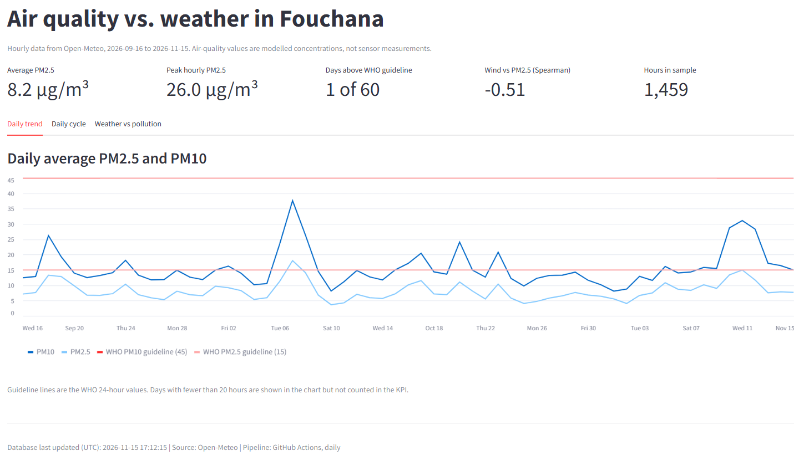
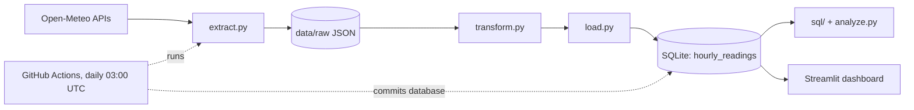
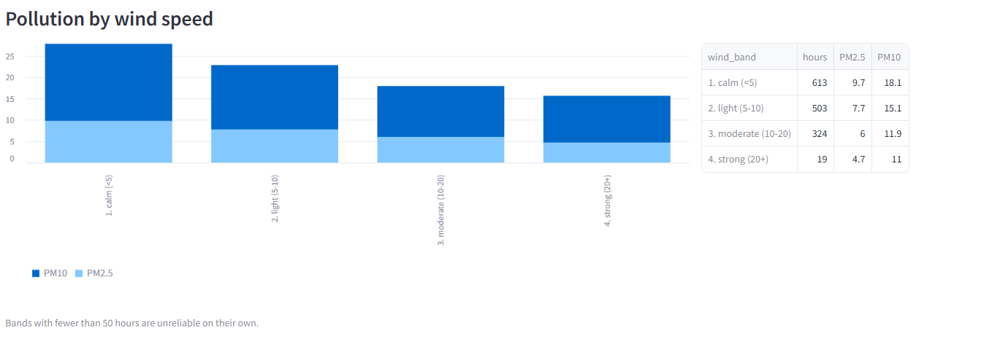
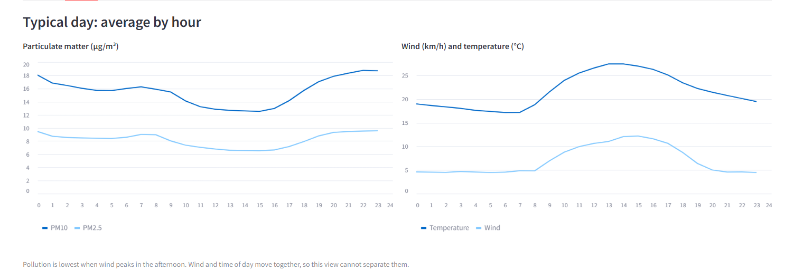
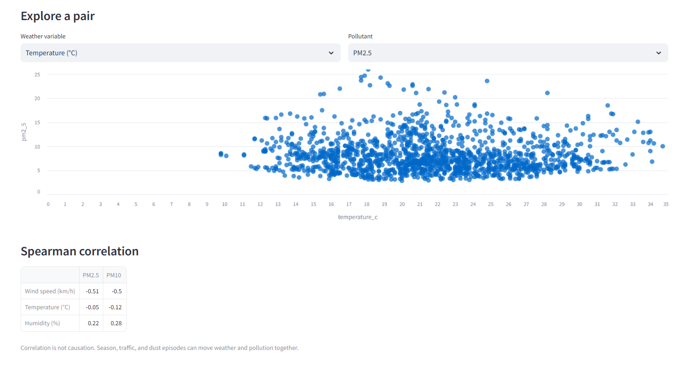

# Weather & Air Quality Data Pipeline


An automated end-to-end data pipeline that collects hourly weather and air-quality data for **Fouchana (Ben Arous, Tunisia)**, cleans it, stores it in a database, analyzes it with SQL, and (Sprint 4) visualizes it in a dashboard. It runs by itself every day on GitHub Actions.
**Live dashboard:** *(link added after deployment)*




## Business Question
How do weather conditions (temperature, wind, humidity) affect air quality (PM2.5, PM10) in Fouchana, Ben Arous (Tunisia), and can we spot pollution trends over time?

## Key Findings
*Based on 1,459 observed hours (60 complete days, 16 Sep to 15 Nov 2026). The numbers update as the pipeline collects more data, so rerun `python src/analyze.py` to refresh them.*
## Dashboard
Pollution drops as wind increases (calm hours average 9.7 µg/m³ PM2.5 vs 6.0 with moderate wind):



Pollution is lowest in the afternoon, when wind and temperature peak. The two move together, so the data cannot separate them:



Temperature shows almost no relationship with PM2.5, while wind has the strongest correlation (-0.51):



**1. Wind is the factor most strongly linked to lower particulate matter.**
Average PM2.5 was 9.7 µg/m³ in calm hours (<5 km/h, 613 hours) versus 6.0 µg/m³ with moderate wind (10-20 km/h, 324 hours). PM10 fell from 18.1 to 11.9 µg/m³. The Spearman correlation with wind speed is -0.50 for PM10 and -0.51 for PM2.5. The "strong wind" band (20+ km/h) looks cleanest (4.7 and 11.0 µg/m³) but has only 19 hours, so it is not reliable on its own.

**2. Pollution follows a daily cycle: cleanest in the afternoon, highest at night.**
PM2.5 averages about 6.5 µg/m³ at 15:00 and about 9.6 µg/m³ late in the evening (PM10: 12.5 vs 18.8). The afternoon is also when wind peaks (about 12 km/h vs about 4.5 km/h at night) and temperature peaks (27 °C). Wind and time of day move together, so this data cannot separate them.

**3. Air was mostly within WHO guideline values, and temperature and humidity matter little.**
Only 1 of 60 complete days (7 Oct) exceeded the WHO 24-hour guideline (PM2.5 18.1 µg/m³ against 15). Temperature has a weak negative correlation with particulate matter (-0.12 PM10, -0.05 PM2.5). Humidity has a weak positive one (0.28 PM10, 0.22 PM2.5), but humidity is highest at night when wind is calm, so it is probably a stand-in for those conditions.

**How to read these results**
- Correlation is not causation. Traffic, season, and dust episodes can change pollution and weather at the same time.
- Values are modelled concentrations, not sensor measurements.
- The data covers about two autumn months, so these patterns may not hold in summer or winter.

## Data Source
[Open-Meteo](https://open-meteo.com) free APIs (no API key needed):
- **Weather API:** temperature (2 m), relative humidity (2 m), wind speed (10 m)
- **Air Quality API:** PM10 and PM2.5

## Tech Stack
| Layer | Tool | Status |
|---|---|---|
| Extract | Python, `requests` (retries, logging) | Done |
| Transform | pandas | Done |
| Load | SQLite via SQLAlchemy (upsert) | Done |
| Testing | pytest | Done |
| Automation | GitHub Actions (daily, 03:00 UTC) | In progress (scheduled runs being verified) |
| Analysis | SQL + pandas | Done |
| Dashboard | Streamlit | Planned (Sprint 4) |

## Pipeline Overview
```
Extract (API) → Transform (pandas) → Load (SQLite) → Analyze (SQL) → Visualize (Streamlit)
   ✅ done         ✅ done            ✅ done          ✅ done         ⏳ Sprint 4

            ⏰ GitHub Actions runs the whole chain every day and commits the database
```

## Project Structure
```
weather-air-pipeline/
├── .github/workflows/
│   └── daily_pipeline.yml   # daily schedule + manual trigger
├── data/
│   ├── raw/                 # raw API responses (JSON), not tracked by git
│   ├── sample/              # one example raw file
│   └── weather_air.db       # SQLite database, updated daily by the workflow
├── src/
│   ├── config.py            # city, coordinates, API settings, paths
│   ├── extract.py           # calls both APIs and saves raw JSON
│   ├── transform.py         # cleans, validates, and merges the raw data
│   ├── load.py              # upserts clean rows into SQLite
│   ├── pipeline.py          # runs extract -> transform -> load
│   └── analyze.py           # runs the SQL files and computes correlations
├── sql/                     # analysis queries (01 to 05)
├── dashboard/               # Streamlit app (Sprint 4)
├── tests/
│   └── test_pipeline.py     # data-quality tests
├── docs/
│   └── retros.md            # sprint retrospectives
├── pytest.ini
├── requirements.txt
└── README.md
```

## Getting Started

**1. Clone and enter the project**
```bash
git clone https://github.com/othmenbelgacem/weather-air-pipeline.git
cd weather-air-pipeline
```

**2. Create a virtual environment and install dependencies**
```bash
python -m venv venv
venv\Scripts\activate          # Windows
source venv/bin/activate       # Mac/Linux
pip install -r requirements.txt
```

**3. Run the analysis on the included database**
```bash
python src/analyze.py
```

**4. Run the pipeline yourself** (use a separate database file, see "Automation" below)
```powershell
$env:DB_PATH = "data/local.db"     # PowerShell
python src/pipeline.py
```

**5. Run the tests**
```bash
python -m pytest
```

## Configuration
Settings live in `src/config.py`. To analyze another city, change one line:
```python
CITY = {"name": "Fouchana", "latitude": 36.70, "longitude": 10.17}
```
Two optional environment variables:
- `DB_PATH`: where the database is written (default `data/weather_air.db`)
- `PAST_DAYS`: how many past days to fetch (default 2; a one-time backfill used 60)

## How the Pipeline Works

**Extract** (`extract.py`)
- Requests the last 2 days plus today (72 hourly rows), so a missed run leaves no gaps.
- Retries up to 3 times on temporary server errors (429, 5xx) with increasing delays.
- Validates that each response contains hourly data.
- Exits with a non-zero code on failure, so GitHub Actions flags a failed run.

**Transform** (`transform.py`)
- Reads the newest raw file for each source and removes duplicate timestamps.
- Merges weather and air quality on the timestamp (one-to-one join).
- Sets physically implausible values to NULL (for example humidity above 100%).
- Keeps missing values as NULL instead of imputing them.
- Adds an `is_forecast` flag for hours that had not happened yet at run time.

**Load** (`load.py`)
- Writes to the `hourly_readings` table with primary key `(city, observed_at)`.
- Uses an upsert, so rerunning never creates duplicates and forecast rows get refreshed with observed values.

**Analyze** (`sql/`, `analyze.py`)
- Five SQL queries: coverage, daily summary, hour-of-day pattern, wind bands, WHO guideline exceedances.
- All queries use `is_forecast = 0`, so predictions never enter the analysis.
- `analyze.py` runs every query and adds Spearman correlations (SQLite has no built-in correlation function).

## Automation
`.github/workflows/daily_pipeline.yml` runs every day at 03:00 UTC (04:00 in Tunisia) and can also be started manually from the Actions tab. Each run:
1. installs dependencies and runs the tests,
2. runs the pipeline,
3. checks that the table is not empty (the run fails otherwise),
4. commits the updated database back to the repository.

The repository holds the database because a workflow starts from a fresh checkout each time. A one-time backfill of 60 days gave the first 1,464 rows.

**Working locally:** run `git pull` before you start, and write to a separate file (`DB_PATH=data/local.db`). Only the workflow should commit `data/weather_air.db`, since a binary file cannot be merged. `data/*.db` is git-ignored except for this one file.

## Data Dictionary (table `hourly_readings`)
| Column | Description |
|---|---|
| city | City name |
| observed_at | Local time (Africa/Tunis, UTC+1) |
| temperature_c | Air temperature at 2 m (°C) |
| humidity_pct | Relative humidity (%) |
| wind_kmh | Wind speed at 10 m (km/h) |
| pm10, pm2_5 | Particulate matter (µg/m³) |
| is_forecast | 1 if the hour was still in the future when loaded, otherwise 0 |
| updated_at | UTC time of the last write |

## Data Quality Tests
`tests/test_pipeline.py` checks that:
- duplicate timestamps are removed
- out-of-range values become NULL
- the output has the expected columns and is sorted by time
- loading the same data twice does not create duplicate rows

The workflow also checks on every run that the table is not empty.

## Methodology
Built with Agile in 1-week sprints, tracked on the GitHub project board. Retrospectives are in [`docs/retros.md`](docs/retros.md).

| Sprint | Goal | Status |
|---|---|---|
| 0 | Setup, user stories, API test | Done |
| 1 | Extract: API calls, retries, logging, raw storage | Done |
| 2 | Transform & load: cleaning, database, tests | Done |
| 3 | Automation (GitHub Actions) & SQL analysis | In progress: waiting for 3 scheduled runs |
| 4 | Dashboard & polish | Planned |

**Sprint 3 demo:** the workflow succeeds in about 25 seconds, the database holds 1,464 hourly rows (60-day backfill), and `python src/analyze.py` produces the findings above.

## Limitations
- Air-quality values are model-based estimates, not ground-sensor measurements.
- Weather and air quality come from slightly different grid points (about 2-3 km apart).
- Timestamps are in local time (Africa/Tunis, UTC+1).
- Hours that were still in the future at run time are forecasts, flagged with `is_forecast = 1` and excluded from the analysis.
- Missing values are kept as NULL, not imputed.
- The history covers about two autumn months, so seasonal patterns cannot be assessed yet.
- If the daily job stops for more than 2 days, some rows stay flagged as forecasts until a later run refreshes them.